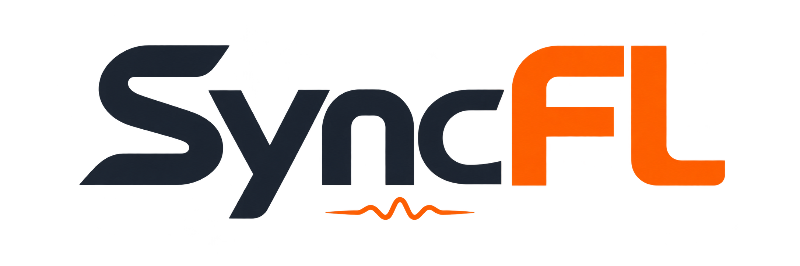

<div align="center">



**157 tools. 4,872 named plugin controls. Music production from one conversation.**

Compose · Arrange · Mix · Design sounds · Automate · Analyze

[](https://github.com/ALX-CODE/SyncFL-MCP/actions/workflows/tests.yml)
[](https://github.com/ALX-CODE/SyncFL-MCP/releases)
[](docs/GETTING-STARTED.md)
[](LICENSE)
[](docs/ARCHITECTURE.md)

[SETUP | INSTALL](#setup--install) · [Capabilities](docs/CAPABILITIES.md) · [All 157 tools](docs/reference/TOOLS.md) · [Plugins](docs/PLUGIN-CONTROL-GUIDE.md) · [Landscape review](docs/COMPARISON-2026-10-12.md) · [Contribute](CONTRIBUTING.md)

[Download a release](https://github.com/ALX-CODE/SyncFL-MCP/releases) · [Questions and demos](https://github.com/ALX-CODE/SyncFL-MCP/discussions) · [Report a bug](https://github.com/ALX-CODE/SyncFL-MCP/issues/new/choose)

</div>

**SyncFL** (**SyncFL-MCP**) brings live session control, composition, arrangement, mixing, sound design, automation, audio analysis and project packaging into one local [Model Context Protocol](https://modelcontextprotocol.io/) server. Give a compatible AI assistant the tools to inspect your session, shape a synth, adjust a vocal chain, route a mix and work with your project files.

| **157** MCP tools | **4,872** named plugin controls | **1,148** qualified mappings | **10,703** calibration checks |
|:---:|:---:|:---:|:---:|
| Documented schemas | Across 50 profiles | Numeric units and menu values | Independent host-display holdouts |

**As of October 12, 2026, following a broad source-based review, we believe SyncFL is one of the most comprehensive FL Studio MCP toolkits available.** The review screened 157 repository trees from 179 public candidates, with deeper examination of 23 projects. [Read the comparison, evidence and remaining gaps →](docs/COMPARISON-2026-10-12.md)

Ask for a musical change, inspect the actual project, preview an exact operation, and check what FL accepted. Guarded workflows use fresh identities, revisions, receipts and later readback so an assistant can explain what changed and what remains uncertain.

**Windows is the primary tested platform. SyncFL is backend-only.** Native APIs and the experimental OLE bridge operate without synthetic keyboard/mouse input. Unsupported operations report a missing backend route; there is no interactive mode.

## What you can do

| Workflow | What the server provides |
|---|---|
| **Inspect a session** | Live transport, channels, mixer, plugins, native capabilities and workflow prerequisites |
| **Compose and arrange** | Background FL26 score import and pattern/sound switching, piano bridge, pattern banks, step sequences, note transforms and saved-FLP clip editing |
| **Mix with exact targets** | Guarded mixer scenes, built-in EQ and strip switches, sends, buses, sidechains, plugin parameter batches and bounded peak-meter observations |
| **Control familiar plugins** | 50 profiles, 4,872 named controls and 1,148 qualified numeric/menu mappings; explicit normalized access where calibration is withheld |
| **Design Serum sounds** | Live mapped controls, native preset inspection/editing, kick/808/lead/pad builders and measured audio probes |
| **Work with audio** | Rust tempo analysis, ranked musical-key estimates, WAV inspection/editing, integrated loudness and true peaks, reference-level comparisons and evidence-based gain proposals |
| **Manage projects** | Saved-FLP inspection, automation edits, source-preserving project packages, guarded open/save and recording/render jobs |

The [capability matrix](docs/CAPABILITIES.md) explains input requirements and limits. The [generated reference](docs/reference/TOOLS.md) documents every registered tool and its parameters.

**Core production tools visible in every session.** The default
[discovery interface](docs/TOOL-DISCOVERY.md) advertises 32 production APIs with
complete schemas, plus four discovery helpers for the rest of the 157-tool catalog.
Loading sounds, writing notes, arranging, mixing and saving require no discovery step.
Specialist tools remain available on demand through the same guarded backend.
Set `FL_MCP_TOOL_MODE=full` for the complete initial tool list.

## SETUP | INSTALL

**Windows · Codex · Claude Desktop · Claude Code**

**1. Install.** Open FL Studio once so its user-data folder exists. With
[Git for Windows](https://gitforwindows.org/) installed, paste this into **PowerShell**:

```powershell
git clone https://github.com/ALX-CODE/SyncFL-MCP.git "$env:USERPROFILE\SyncFL-MCP"; if ($?) { & "$env:USERPROFILE\SyncFL-MCP\Install.cmd" -Cli }
```

Choose your assistant when prompted. Setup installs Python 3.13, dependencies,
the FL controller and the optional `syncfl` CLI, then configures your chosen
assistant with backups. Keep the new `SyncFL-MCP` folder in your user folder.

**No Git?** [Download the ZIP](https://github.com/ALX-CODE/SyncFL-MCP/archive/refs/heads/main.zip),
extract it to a permanent folder, and double-click **`Install.cmd`**.
**Already cloned?** Run `.\Install.cmd -Cli` from that folder.

**2. Connect FL Studio.** Restart your assistant so it starts SyncFL, then open
FL Studio. In **Options → MIDI settings**, enable **ALX FL Bridge (FL Studio)**,
select **FL Studio MCP Controller**, and assign an unused MIDI port number.

**3. Check the connection.** Ask your assistant:

> Run `fl_build_info`, `fl_connection_status` and `fl_session_inspect`. Report any failed checks before making changes.

The native bridge needs compatible **Windows MIDI Services loopback support** and
Microsoft's **x64 VC++ runtime**. No loopMIDI app is needed. See
**[full setup and requirements](docs/GETTING-STARTED.md)** or
**[troubleshooting](docs/TROUBLESHOOTING.md)** if a check fails.

### Let your AI assistant set it up

Paste this 40-word prompt into a coding assistant with access to your computer:

```text
Set up SyncFL-MCP from https://github.com/ALX-CODE/SyncFL-MCP on this Windows PC. Read its setup guide, check prerequisites, install it for my MCP client, preserve existing configuration, and verify connectivity. Ask which client I use and explain any required manual FL Studio steps.
```

**Contributing? Run `Develop.cmd`.** It clones or reuses your local SyncFL Git
checkout and installs development tools plus the `syncfl` CLI. Offline developer
setup leaves FL and assistant settings alone. [Developer setup →](docs/DEVELOPER-SETUP.md)

For a new beat in a clean unnamed Empty project, `fl_project_create` creates and
loads the named FLP, initializes Pattern 1 and saves it through the backend. Run
it before adding sounds or notes; no manual first save is needed.

## A useful first session

- “Inspect this project and list the channels, mixer routing and loaded effects. Don't change anything yet.”
- “Preview a mixer scene that lowers these named backing-vocal tracks by 2 dB. Show the exact targets before applying it.”
- “Inspect the Pro-Q instance on this track and show its available named controls and units.”
- “Compare these two rendered WAVs for loudness and true peak. Explain the measurements before proposing gain changes.”
- “Analyze this WAV's key and show the five strongest major/minor candidates before adjusting any tuning.”
- “Create a transposed copy of these notes, preserving timing and expression, and show the proposed result.”

These are task examples, not guarantees that an arbitrary assistant will infer your intended sound. The [workflow guide](docs/WORKFLOWS.md) shows inspect → preview → apply → verify sequences.

Key analysis also works as a [standalone NumPy module](docs/KEY-ANALYSIS.md), with no FL Studio connection, FFmpeg or desktop input. Estimates describe a whole recording; relative confidence is not a calibrated probability.

[`fl_audio_bpm`](docs/TEMPO-ANALYSIS.md) uses an original Rust core with no third-party crates. It reports tempo candidates and half/double-time relationships, and leaves your project tempo untouched.

## Plugin precision

| Coverage | Profiles |
|---|---|
| Qualified numeric/menu controls; other controls remain normalized-only | Auto-Tune Pro; MetaTune; FabFilter Pro-Q 4, Pro-C 3, Pro-DS, Pro-L 2, Pro-R 2 and Saturn 2; soothe2; Tube-Tech CL 1B mk II; Soundtoys Decapitator, EchoBoy, MicroShift and Little AlterBoy |
| Stock effects | 26 profiles, including Parametric EQ 2, Limiter, Maximus, Delay 3, Reeverb 2 and Gross Beat; [coverage and limits](docs/STOCK-PLUGIN-GUIDE.md) |
| Stock instruments | 3x Osc, FL Keys, FL Slayer, Morphine, Ogun, PoiZone, Sakura, Sawer, Sytrus and Toxic Biohazard |
| Separate Serum integration | Serum 2 live controls, native preset tools and audio probing |

Mappings bind to the **exact exposed parameter layout**. Changed layouts are refused. 37 of the 50 profiles retain qualified mappings: 576 numeric and 572 menu controls, after 10,703 independent host-display holdout checks. Other profiles expose named normalized controls or detection only. Mode-dependent controls declare the selector setting they were qualified under. Counts include repeated band controls; they do not mean every control is calibrated. Host readback does not certify audible DSP behavior.

[Plugin units, conditions and limitations →](docs/PLUGIN-CONTROL-GUIDE.md)

## Backend-only operation

SyncFL uses native controller APIs, offline files and the experimental native OLE bridge.
Desktop input and focus-dependent automation are unavailable. The legacy
`FL_MCP_INTERACTION_POLICY` setting is ignored; it cannot enable UI input.

WAV samples, FST instruments/presets/effects and saved FL26 projects use native loading.
The bridge may expose the addressed FL panel without activating the OS foreground window.
Inspect exact identities and receipts; never replay an uncertain load.

Project loading requires the current named project path and a new recovery copy. Unnamed
projects, GUI Save As/export and other unmigrated dialog workflows remain unavailable.
Native host readback is distinct from audio, licensing and exact filesystem-path proof.

## Built to be inspectable

- **Exact targets:** global channel indices, expected names, layout checks and fresh revisions.
- **Preview first:** newer guarded APIs preflight before a caller explicitly applies changes.
- **Evidence after writes:** later readbacks and retained receipts; uncertain mutations are not automatically replayed.
- **Preserved sources:** saved-project and audio editors create new files rather than silently replacing inputs.
- **Local transport:** MCP stdio, local request/response files and a MIDI wakeup. Windows output uses SyncFL's bundled C++20 transport; no cloud account is required by this server.

Legacy low-level tools have different guarantees. A batch is not a universal rollback transaction. Your chosen AI client has its own data handling. See [security and privacy](SECURITY.md).

## Development and validation

```powershell
uv sync --locked --python 3.13 --extra serum --extra audio --extra dev
uv run --no-sync python -m pytest tests -q
uv run --no-sync python scripts/generate_tool_docs.py --check
uv run --no-sync python scripts/check_public_docs.py
```

The October 12 background-control pass passed **2,317 tests on Python 3.13** (two skips), **16 live native change/restore cases**, and a fresh-server EQ/switch apply with exact restoration. The C++ MIDI transport separately passed **43 native cases and 11 CTest checks**, plus live FL handshakes and an installed-wheel check with Mido/RtMidi imports blocked. The earlier source-replacement run passed **2,290 tests on Python 3.14** (six skips). [Windows CI](https://github.com/ALX-CODE/SyncFL-MCP/actions/workflows/tests.yml) runs the locked suite on **Python 3.12, 3.13 and 3.14** and builds the native transport; **3.13 is the recommended installer baseline**. Windows users no longer need to compile RtMidi. Python 3.15 is not yet qualified with the pinned optional dependencies. These are dated results, not proof of every host/plugin combination. CI needs no FL or commercial plugin licenses. Live observations and startup-focus limitations are documented separately in [validation](docs/VALIDATION.md).

[Contributing](CONTRIBUTING.md) · [Architecture](docs/ARCHITECTURE.md) · [Configuration](docs/CONFIGURATION.md) · [Changelog](CHANGELOG.md) · [Roadmap](docs/ROADMAP.md)

## Credits and publication

**SyncFL** (repository: **SyncFL-MCP**) is developed and maintained by **[ALX-CODE](https://github.com/ALX-CODE)** and **[nobibasedd](https://github.com/nobibasedd)**. See [contributors](CONTRIBUTORS.md), [source provenance](docs/SOURCE-PROVENANCE.md), [license](LICENSE) and [third-party notices](NOTICE.md).

Source code is **MIT**. FL Studio and commercial plugins require their own installations and licenses. This is an independent project, not an Image-Line or plugin-vendor product.

The SyncFL repository starts with clean history and excludes private production material. Keep song projects, reference libraries and commercial media outside this repository. Follow the [public release guide](docs/PUBLIC-RELEASE.md) when preparing source snapshots; never merge private development history into this repository.
