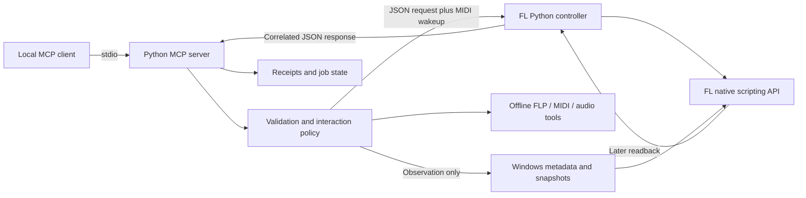

# Architecture

The repository has three connected layers: an MCP server, FL controller scripts, and optional platform-specific helpers. It does not embed FL Studio or host commercial plugins itself.

## Server and native transport

`src/fl_studio_mcp/server.py` registers the tool modules and the complete-call lease middleware. Tool adapters validate public arguments and call utilities with more detailed target/state checks.

The MIDI connection writes a correlated request to local files and sends a dedicated MIDI wakeup. `fl_controller/device_FLStudioMCP.py`, `mcp_extended.py` and `mcp_production.py` execute supported operations inside FL's scripting environment. Responses contain request identity and outcomes. A bounded replay cache reduces duplicate dispatch; it is not an unlimited cross-restart exactly-once guarantee.

On supported Windows hosts, `native/midi_bridge` creates/reuses an owned Windows MIDI Services loopback pair. The helper exits; the OS carries MIDI. The endpoints expire on service restart/reboot and must be recreated before FL scans them. Existing virtual MIDI routes remain configurable.

`native/midi_transport` supplies the C++20 WinMM output DLL and diagnostic CLI.
The Windows Python connection uses its lazy, hash-verified ctypes binding instead
of Mido/RtMidi for endpoint enumeration and wakeups. Protocol-2 mailboxes, expiry,
locks, request IDs and response checks stay in Python. Mido remains for MIDI
files, and non-Windows output retains RtMidi. See the [transport contract](../native/midi_transport/README.md).

## Validation and concurrency

High-level guarded edits inspect current identity/revision, validate the full request, reserve a new receipt, dispatch once and compare later readbacks. Partial or uncertain outcomes remain explicit. There is no universal atomic rollback across arbitrary DAW operations.

A complete-call lease serializes cooperating MCP clients. Offline tools can run independently where the catalog permits. Direct legacy clients or manual UI changes can still race; fresh identities and preconditions reduce that risk without claiming exclusive ownership of the desktop.

The controller digest captured at load distinguishes running code from files merely updated on disk. The server likewise reports its imported build. Reload both sides after upgrades.

## Input policy

`interaction_policy.py` and `native_interaction_policy.py` reject desktop input and focus-dependent calls for every caller, including nested command batches. Native functions whose behavior depends on focus have narrower accepted forms. There is no desktop-input mode or environment opt-in.

Some functions combine observation with a UI action. Their names alone do not establish read-only or background behavior. The operator catalog contains explicit classifications; unknown tools are conservatively treated as potential writes.

## Plugins

Generic plugin tools expose FL parameter indices, normalized values and displayed text. Named adapters bind an entire exposed layout before providing stable names and qualified numeric/enum mappings. Controls without qualified conversions remain normalized-only. Mode dependencies, units and allowed ranges are checked before writes.

Parameter/display agreement is host evidence. Plugin caches may be stale, matching names/layouts do not uniquely attest a binary version, and readback does not certify the sound produced by DSP.

Serum has separate native preset codecs/builders and its own mapped-control/probe workflow. Those tools do not make the general adapter registry support arbitrary preset formats.

## Offline state and native helpers

Saved-FLP readers/editors preserve unknown/unmodified events and create output copies. Supported version/layout boundaries remain explicit. Audio/MIDI operations report file hashes and measurements; they do not silently update the live DAW.

The experimental OLE effect loader uses a pinned helper and narrow process/window/slot checks. FL routes the drop by screen position, so the loader refuses a slot whose drop point another window covers; earlier failed tests were traced to a maximized Playlist in front of the Mixer. The private interface remains experimental and is not general import support. The FL SDK bridge is a fake-host-tested research prototype; note writes remain disabled. These components are separate from the working MIDI transport.

## Repository map

| Path | Responsibility |
|---|---|
| `src/fl_studio_mcp/tools/` | MCP schemas and tool registration |
| `src/fl_studio_mcp/utils/` | Validation, transport, file codecs, workflows and platform helpers |
| `fl_controller/` | Python controller deployed into FL |
| `scripts/` | Setup, diagnosis, reference generation and release checks |
| `native/midi_bridge/` | Working Windows MIDI Services helper/runtime |
| `native/background_bridge/` | Experimental background OLE loader |
| `native/fl_host_bridge/` | Native FL SDK research prototype |
| `tests/` | Offline unit/integration/packaging regression tests |
| `agent-harness/` | Optional command-line wrapper and tests |
| `docs/` | User/developer guides and generated reference |

Private production projects and reference media in the working repository are excluded from [public exports](PUBLIC-RELEASE.md).
